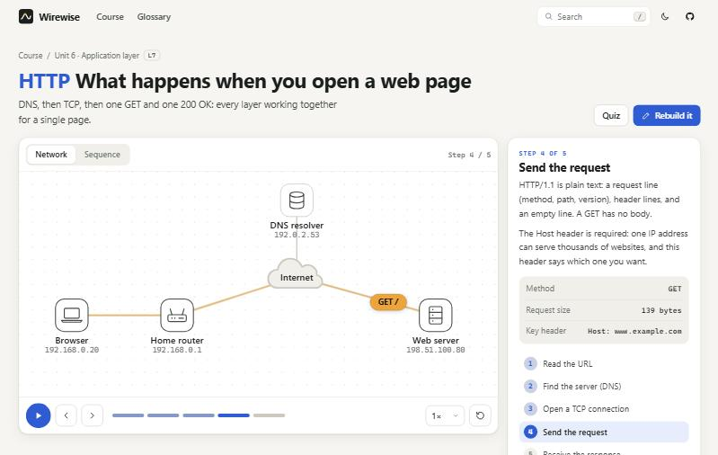
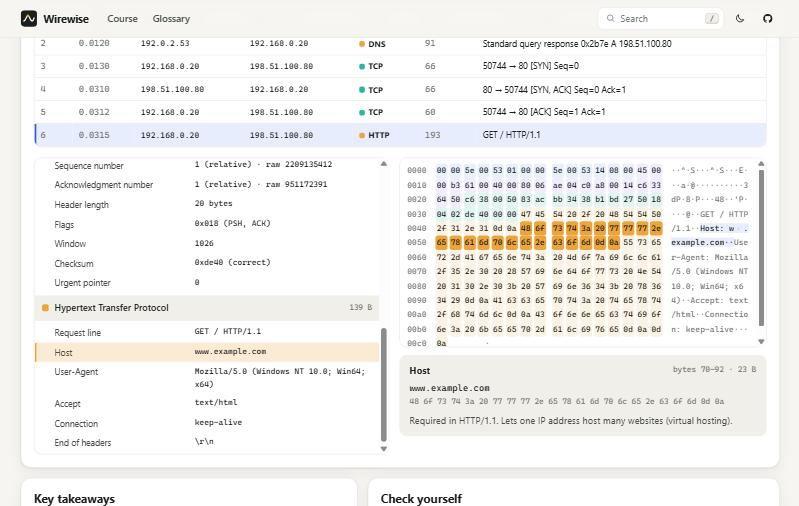
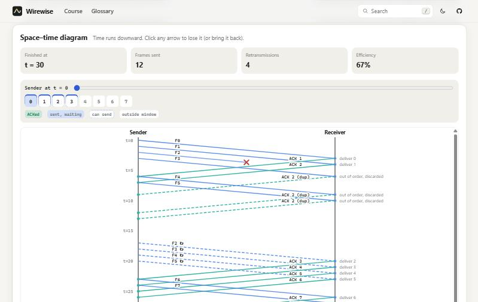

# Wirewise

**Computer networks, packet by packet.**

A free, interactive computer networks course that runs entirely in your browser. Watch real packets cross a network, open every header down to the byte, and practise the algorithms from a university networks syllabus in hands-on labs.

[](https://github.com/VishwakSai1805/wirewise/actions/workflows/deploy.yml)


**Live site: [vishwaksai1805.github.io/wirewise](https://vishwaksai1805.github.io/wirewise/)**



## Contents

- [Why Wirewise](#why-wirewise)
- [What’s inside](#whats-inside)
- [Screenshots](#screenshots)
- [Keyboard shortcuts](#keyboard-shortcuts)
- [Run it locally](#run-it-locally)
- [Deploy your own copy](#deploy-your-own-copy)
- [How it works](#how-it-works)
- [Project structure](#project-structure)
- [Adding a lesson](#adding-a-lesson)
- [Adding a lab](#adding-a-lab)
- [Accuracy and conventions](#accuracy-and-conventions)
- [Roadmap](#roadmap)
- [Feedback](#feedback)
- [License](#license)

## Why Wirewise

Networking is usually taught with static diagrams, but the ideas are about motion: a packet leaves, a timer runs out, a window slides, a header changes at every hop. Wirewise shows those moments as they happen.

- **For students** of a computer networks course, or anyone preparing for CCNA or Network+.
- **For teachers** who want a free, ad-free demo to put on a projector.
- **For the curious** who want to know what really happens when you press Enter in the address bar.

Everything is free. There are no accounts, no ads, no paywalls and no tracking.

## What’s inside

### Animated protocol lessons

Each lesson has five steps, with a network view, a sequence diagram, a packet list and a byte-level packet inspector.

| Lesson | Layer | What you watch |
| --- | --- | --- |
| **ARP** | L2 | A broadcast request, a unicast reply, a switch learning ports, the ARP cache, then the first ping |
| **DHCP** | L7, configures L3 | Discover, Offer, Request, ACK; leases, renewal at T1 and T2, relay agents |
| **ICMP** | L3 | Ping round trips, then traceroute raising the TTL one hop at a time |
| **TCP** | L4 | The three-way handshake, sequence and acknowledgment arithmetic, piggybacked ACKs, the four-way close and TIME_WAIT |
| **DNS** | L7 | A recursive resolver walking root → .com → authoritative, glue records, then a cache hit with the TTL counting down |
| **HTTP** | L7 | A whole page load: DNS, the TCP handshake, GET and 200 OK |

Every lesson also includes:

- **Quiz**: 4–5 multiple-choice questions, each with an explanation.
- **Rebuild exam**: recreate the whole exchange from memory. It is graded and links each mistake back to the step that explains it.
- **Key takeaways**, RFC references and **printable notes** (print the page to get every step as text).

### Labs for the syllabus algorithms

| Lab | Syllabus topic | What you can do |
| --- | --- | --- |
| **Encapsulation** | Layered models | Type a message and watch each layer wrap it in a real header; see the protocol overhead and an OSI vs TCP/IP table |
| **Line coding** | Physical layer | Draw NRZ-L, NRZ-I, Manchester, differential Manchester, AMI and pseudoternary signals for any bits |
| **Error detection & correction** | Data link layer | CRC long division with bit flipping, Hamming encoding and syndrome decoding, the Internet checksum with end-around carry |
| **Sliding window protocols** | Data link / transport | Stop-and-Wait, Go-Back-N and Selective Repeat on a space–time diagram; click any frame or ACK to lose it |
| **Subnetting & CIDR** | Network layer | A calculator with a binary view, subnet splitting, and generated practice questions |
| **Routing algorithms** | Network layer | Dijkstra’s table step by step with the resulting forwarding table; distance-vector rounds until convergence; editable link costs |
| **TCP congestion control** | Transport layer | Tahoe and Reno side by side; add losses from 3 duplicate ACKs or timeouts and watch cwnd and ssthresh react |

### Also included

- **Glossary** of 35 terms, most linked to the lesson or lab that shows them.
- **Search** across lessons, labs and terms.
- **Progress tracking** stored only in your browser, with export and import to move it to another device.
- **Light and dark themes** that follow your system setting.
- **Works on phones** and respects your system’s reduced-motion setting. Lessons can be driven from the keyboard.
- **Small**: about 45 KB of JavaScript on first load (gzipped). Each lab is downloaded only when you open it.

## Screenshots

**Packet inspector.** Every field is decoded and explained, and its bytes light up in the hex dump.



**Sliding window lab.** Go-Back-N recovering from a lost frame. Click any arrow to lose it or bring it back.



## Keyboard shortcuts

| Key | Action |
| --- | --- |
| `Space` | Play or pause the lesson |
| `←` `→` | Previous or next step |
| `N` / `S` | Network view / sequence view |
| `/` or `Ctrl` + `K` | Open search |
| `Esc` | Close search |

## Run it locally

You need [Node.js](https://nodejs.org/) 20 or newer.

```bash
git clone https://github.com/VishwakSai1805/wirewise.git
cd wirewise
npm install
npm run dev
```

Then open the address it prints (usually http://localhost:5173).

| Command | What it does |
| --- | --- |
| `npm run dev` | Start a local server that reloads as you edit |
| `npm test` | Run the unit tests |
| `npm run build` | Type-check and build the production site into `dist/` |
| `npm run preview` | Serve the production build locally |

## Deploy your own copy

The site is static, so GitHub Pages hosts it for free.

1. Fork or push this repository to GitHub. On a free account the repository must be public to use Pages.
2. Open **Settings → Pages** and set **Source** to **GitHub Actions**.
3. Push to `main`. The workflow in [`.github/workflows/deploy.yml`](.github/workflows/deploy.yml) runs the tests, builds the site and publishes it to `https://<your-username>.github.io/<repo-name>/`.

To rebrand it, change the name and repository link in [`src/site.ts`](src/site.ts).

## How it works

- **Real packets.** The encoders in [`src/packets/`](src/packets) build each frame byte by byte: Ethernet, ARP, IPv4, UDP, TCP, ICMP, DNS (with name compression), DHCP and HTTP. Lengths and checksums are computed, not typed in, and short frames are padded to Ethernet’s 60-byte minimum. Every field records its byte range, which is what lets the inspector highlight it in the hex dump.
- **Tested against textbook answers.** The lab algorithms in [`src/labs/algo/`](src/labs/algo) are plain functions with unit tests. The tests check the RFC 1071 checksum example, a classic IPv4 header checksum (0xb861), Tanenbaum’s CRC example, Hamming(7,4) correcting every single-bit error, the six-router Dijkstra network from Kurose & Ross, and the standard Tahoe/Reno curves. They also verify every lesson packet’s IP, UDP and TCP checksums.
- **Data-driven lessons.** A lesson is one TypeScript file describing devices, links, packets, steps and a quiz. The same player renders every lesson.
- **Small and fast.** The site is built with [Preact](https://preactjs.com/), the only runtime dependency, plus [Vite](https://vite.dev/) and TypeScript. Animations use `requestAnimationFrame`, and only the diagram redraws while a lesson plays.
- **GitHub Pages friendly.** Hash URLs such as `#/learn/tcp?step=3` work without any server configuration, and every lesson step has a shareable link.
- **Private by design.** Progress is saved in `localStorage` on your device. Nothing is sent anywhere.

## Project structure

```
src/
  packets/          packet encoders and checksum helpers (+ tests)
  course/
    lessons/        one file per protocol lesson
    syllabus.ts     units, labs, and the order of the course
    glossary.ts     glossary terms
    grade.ts        grading for the rebuild exams
  components/       lesson player, network and sequence views, inspector, quiz, search
  labs/             one component per lab
    algo/           the lab algorithms (+ tests)
  pages/            home, lesson, exam, lab and glossary pages
  lib/              hash router, progress storage, theme
  styles/           CSS for the light and dark themes
  site.ts           site name and repository link
docs/screenshots/   images used in this README
```

## Adding a lesson

1. Create a file in [`src/course/lessons/`](src/course/lessons), using an existing lesson as a template. A minimal lesson looks like this:

   ```ts
   import { data, udpFrame } from '../../packets/layers'
   import { IP, MAC } from '../net'
   import { once, type Lesson } from '../types'

   export const udpLesson: Lesson = {
     id: 'udp',
     title: 'Sending a datagram',
     protocol: 'UDP',
     layer: 'L4',
     tagline: 'One message, no handshake.',
     summary: 'UDP adds ports and a checksum to IP, and nothing else.',
     capture: 'Captured on the client.',
     devices: [
       { id: 'client', label: 'Client', sub: IP.client, kind: 'laptop', x: 150, y: 230 },
       { id: 'server', label: 'Server', sub: IP.web, kind: 'server', x: 850, y: 230 },
     ],
     links: [['client', 'server']],
     participants: ['client', 'server'],
     packets: [
       {
         id: 'hello', label: 'Datagram', from: 'client', to: 'server', t: 0,
         paths: [['client', 'server']], info: '50000 → 9000 Len=5',
         build: once(() => udpFrame(
           { srcMac: MAC.client, dstMac: MAC.router, ip: { src: IP.client, dst: IP.web } },
           50000, 9000, data('hello'))),
       },
     ],
     steps: [{ title: 'Send it', body: ['No connection is set up first.'], packets: ['hello'] }],
     takeaways: ['UDP is connectionless.'],
     quiz: [{ q: 'Does UDP retransmit lost data?', options: ['Yes', 'No'], answer: 1, why: 'Reliability is left to the application.' }],
     references: [{ label: 'RFC 768: User Datagram Protocol', url: 'https://www.rfc-editor.org/rfc/rfc768' }],
   }
   ```

2. Register it in [`src/course/lessons/index.ts`](src/course/lessons/index.ts) and add it to a unit in [`src/course/syllabus.ts`](src/course/syllabus.ts).
3. Run `npm test`. The tests check that every packet builds with valid checksums, and that every step and path refers to packets and devices that exist.

Device positions use a 1000 × 470 canvas. Device kinds are `laptop`, `pc`, `phone`, `printer`, `router`, `switch`, `server`, `dns` and `cloud`.

## Adding a lab

1. Put the algorithm in [`src/labs/algo/`](src/labs/algo) as plain functions, and add tests for it in `algo.test.ts`.
2. Build the interface as a component in [`src/labs/`](src/labs) with a default export. Shared controls (sliders, segmented buttons, bit toggles) live in [`src/labs/ui.tsx`](src/labs/ui.tsx).
3. Register it in the `loaders` map in [`src/pages/LabPage.tsx`](src/pages/LabPage.tsx), then add it to `labs` and to a unit in [`src/course/syllabus.ts`](src/course/syllabus.ts).

## Accuracy and conventions

- IP addresses come from private and documentation ranges (RFC 1918, RFC 5737) and MAC addresses from the documentation range (RFC 7042). The root and .com server addresses in the DNS lesson are the real public ones.
- Where textbooks disagree, the lab says which convention it uses:
  - **NRZ-L** follows Forouzan (0 = high).
  - **Manchester** follows IEEE 802.3 (0 = high → low).
  - **Sliding window** ACKs name the next frame expected (Go-Back-N, Stop-and-Wait) or the frame received (Selective Repeat).
  - **Slow start** does not overshoot ssthresh.
- Traceroute is shown Windows-style, with ICMP echo probes; the lesson explains the UDP variant used on Linux and macOS.

## Roadmap

- Lessons: TLS 1.3 handshake, Wi-Fi association and CSMA/CA, NAT, IPv6 and neighbour discovery, SMTP and IMAP, QUIC.
- Labs: ALOHA and CSMA/CD efficiency, VLSM, and opening your own `.pcap` capture in the inspector.
- Translations of the interface and lessons.

## Feedback

Found a mistake in a lesson or lab, or have an idea for a topic? Please [open an issue](https://github.com/VishwakSai1805/wirewise/issues) and mention the lesson and step.

## License

No license has been chosen yet, so all rights are reserved by the author.

---

Made by [VishwakSai1805](https://github.com/VishwakSai1805).
